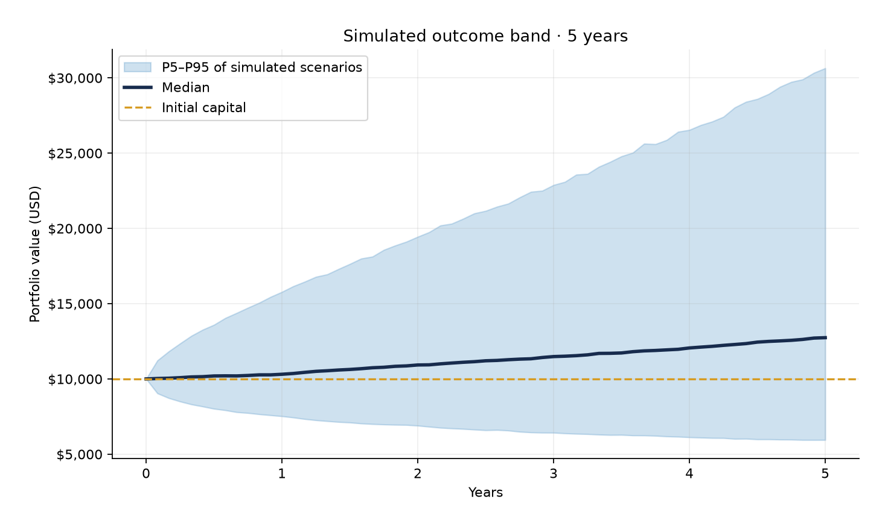

# Portfolio Monte Carlo Lab

A local Python research simulator for a three-asset portfolio: Bitcoin (BTC), the S&P 500, and Gold. It uses hypothetical inputs and generates reproducible scenario paths, statistics, CSV files, and PNG charts. **Educational research tool only; not financial advice or a real-world forecast.** No accounts, APIs, keys, or web app are needed.

## Start in Windows PowerShell

Install Python 3.12 or newer and Git. In PowerShell:

```powershell
git clone https://github.com/ariefzzz5421/Monte-Carlo.git
cd Monte-Carlo
py -3.12 -m venv .venv
.\.venv\Scripts\Activate.ps1
python -m pip install -r requirements.txt
python simulation.py
```

If PowerShell blocks script activation, run `.\.venv\Scripts\python.exe -m pip install -r requirements.txt` and `.\.venv\Scripts\python.exe simulation.py` directly. In VS Code or Cursor, open the repository folder and select `.venv\Scripts\python.exe` as the interpreter. On macOS/Linux, use `python3 -m venv .venv`, `source .venv/bin/activate`, then the same `python` commands.

The first run writes `results/simulation_summary.json`, `results/final_portfolio_values.csv`, `results/percentile_paths.csv`, and five PNGs in `results/charts/`. Later unnamed runs use a new UTC timestamped folder under `results/runs/`, so prior results are retained. Results are ignored by Git except for the empty folder marker.

## Run an experiment

```powershell
python simulation.py --help
python simulation.py --config configs/default.json
python simulation.py --years 10 --simulations 10000
python simulation.py --years 1 --simulations 2000 --rebalancing monthly --seed 42 --run-name monthly-study
python -m pytest -q
```

`--run-name` saves in `results/runs/<name>` and rejects a name that already exists. To reproduce an experiment, keep the same JSON file, seed, scenario count, horizon, and rebalancing rule. The summary records every effective assumption, including CLI overrides. The same inputs and software versions yield the same random scenarios. Version ranges are in `requirements.txt`; for strict archival reproduction, also save `python -m pip freeze` alongside your results.

## Change assumptions

Copy `configs/default.json` to another JSON file and pass it with `--config`. Edit initial capital, all three weights, annual expected returns, annual volatility, correlation matrix, horizon, scenario count, rebalancing, and seed there. Asset keys and the matrix row/column order are **BTC, S&P 500, Gold**. Weights must be nonnegative and sum to 1. Correlations must form a symmetric positive semidefinite matrix with 1s on the diagonal. The CLI reports a useful error if these rules fail.

The default inputs are **illustrative educational assumptions, not current estimates or predictions**:

| Asset | Weight | Expected simple 1Y return | Annual volatility |
|---|---:|---:|---:|
| BTC | 30% | 12% | 60% |
| S&P 500 | 40% | 8% | 20% |
| Gold | 30% | 5% | 16% |

The example pairwise correlations are BTC/S&P 500 = 0.30, BTC/Gold = 0.10, and S&P 500/Gold = 0.05. Initial capital is $10,000; horizon is 5 years; 10,000 scenarios use seed 42 with annual rebalancing.

## What the model means

Monte Carlo simulation makes many random *possible outcomes under a chosen model*. It describes the spread of those modeled outcomes, not the chance of an actual future event. Here each asset follows **geometric Brownian motion (GBM)**: its monthly growth is positive and its log return has a drift plus a normally distributed shock. The annual input return is an **arithmetic expected one-year simple return**, not an assumed annual compounded rate. The annual volatility is the GBM diffusion parameter: the standard deviation of a one-year log-return shock. The code uses `ln(1 + expected_return)` in the drift so the model's expected one-year simple return matches that input. Each scenario's realized compound annual growth rate (CAGR) is calculated afterward from its final portfolio value.

Correlated shocks make assets tend to rise or fall together to the extent specified by the matrix. Higher positive correlation can weaken diversification in this model; low or negative correlation can improve it. The same seed generates all ten years once, and the 1Y, 5Y, and 10Y comparison slices the same scenarios. Monthly, annual, and no rebalancing mean that holdings are returned to target weights at the end of each month, each 12th month, or never. No contributions, withdrawals, fees, taxes, inflation, or dividends are modeled separately; the chosen return assumptions would have to incorporate any intended effects.

## Read the results

- `simulation_paths.png` shows up to 100 individual scenarios, a median, and initial capital.
- `percentile_band.png` shows the median with P5–P95 **simulation percentile band**. It is not a statistical confidence interval or a prediction guarantee.
- `final_values_histogram.png` shows the spread of final dollar values up to P99; an annotation counts outcomes beyond the axis, and all values remain in the CSV.
- `drawdown_distribution.png` shows each scenario's largest peak-to-trough portfolio loss over the selected horizon.
- `horizon_comparison.png` compares median and P5–P95 final values at 1Y, 5Y, and 10Y.

`simulation_summary.json` also gives the mean and median final value, P5/P95, the share finishing below initial capital or at least double, distributions of CAGR and maximum drawdown, and 95% Value at Risk (VaR) and expected shortfall (ES). **Loss convention:** terminal dollar loss = initial capital − final value over the selected full horizon. A negative loss is a gain. VaR is the 95th percentile of these losses; ES is the mean loss among scenarios at or above that percentile. Both can be negative if even the modeled lower tail gained money. They are *terminal* risk measures, not one-month or intrahorizon peak-loss measures. `final_portfolio_values.csv` contains one row per scenario; `percentile_paths.csv` contains each monthly P5/median/P95.

Sample output from the default 10,000-scenario experiment: 

After running the project, open the other generated PNG files in `results/charts/`.

## GitHub Actions

Every push to `main`, or a manual **Actions → Portfolio simulation → Run workflow**, installs dependencies, runs pytest, and executes a small 500-scenario experiment. Its JSON, CSV, and charts are uploaded as a downloadable workflow artifact. The workflow does not deploy anything.

## Model limits

GBM assumes normally distributed log returns with fixed return, volatility, and correlation parameters. Real markets can have **fat tails** (more extreme moves than a normal model), abrupt regime changes, changing correlations, liquidity gaps, and estimation error. BTC, equity, and gold histories do not reliably determine future parameters. Rebalancing can require trades and costs absent from this model. More scenarios reduce Monte Carlo sampling noise **inside the model** but do not fix model risk or make hypothetical probabilities reliable forecasts.

## Code map

`simulation.py` handles the CLI and exports; `src/config.py` validates JSON; `src/engine.py` simulates GBM; `src/portfolio.py` rebalances holdings; `src/analytics.py` computes statistics; `src/visualization.py` saves charts; `tests/` contains pytest checks. The existing MIT license is in `LICENSE`.
